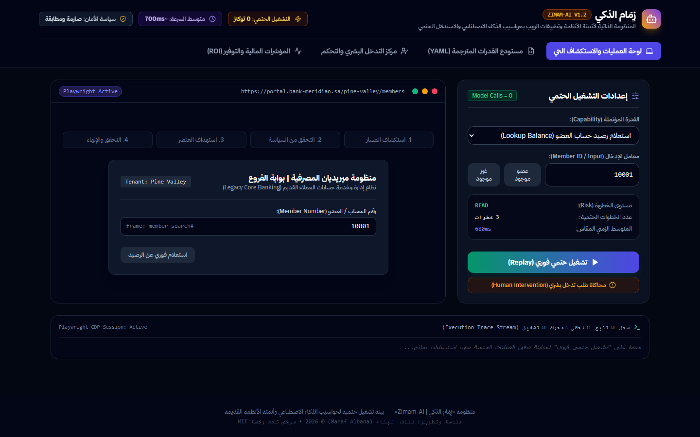
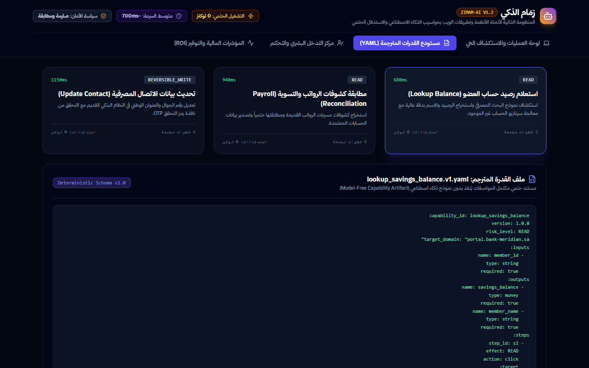
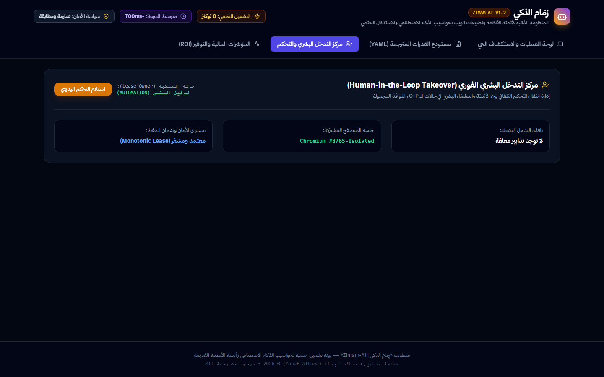
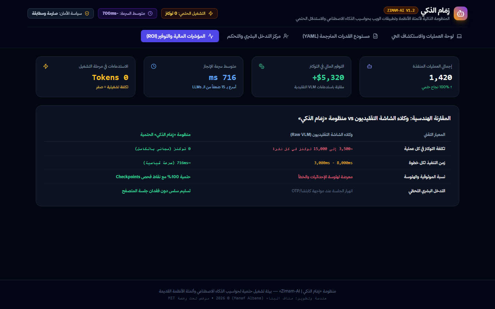
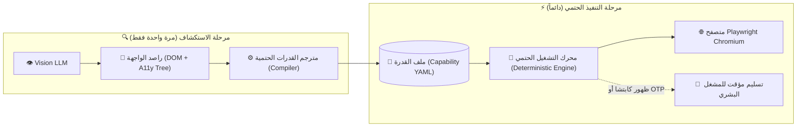

# 🤖 زِمَام الذكي | Zimam-AI

<div align="center">

[](https://github.com/manaf-albana)
[](https://nextjs.org)
[](https://fastapi.tiangolo.com)
[](https://playwright.dev)
[](LICENSE)

**منظومة زِمَام: أتمتة الأنظمة وتطبيقات الويب بحواسيب الذكاء الاصطناعي وبصفر استهلاك توكنز**  
*Deterministic Browser & GUI Automation Runtime: Discover Once with Vision Models, Replay Forever at ~700ms with 0 Model Calls.*

---

[🚀 البدء السريع](#-دليل-التشغيل-والبدء-السريع) • [⚡ مقارنة الأداء والسرعة](#-مقارنة-الكفاءة-والأداء) • [🧠 المعمارية التقنية](#-المعمارية-التقنية-architecture) • [📸 واجهات المنظومة](#-واجهات-المنظومة) • [📬 للتواصل](#-المطور-وحقوق-الملكية)

</div>

---

## 📌 عن المنظومة (System Overview)

تعتمد معظم حلول وكلاء أتمتة واجهات المستخدم (Vision GUI Agents) الحالية على إرسال لقطات شاشة متكررة للنماذج البصرية (Vision LLMs) في كل خطوة، مما يسبب **تكاليف باهظة، وبطئاً شديداً (10-20 ثانية لكل إجراء)، ومعدل فشل مرتفع**.

صُممت منظومة **«زِمَام الذكي | Zimam-AI»** لابتكار نمط عمل ثوري:
1. **الاستكشاف الذكي لمرة واحدة (One-Time Vision Discovery)**: يقوم النموذج البصري بتحليل عناصر الصفحة وشجرة إمكانية الوصول (Accessibility Tree) واستنتاج المسار المطلوب.
2. **الترجمة الحتمية (Deterministic Capability Compiler)**: تحويل مسار التفاعل إلى ملف قدرة حتمي يعتمد على المحددات الدلالية وليس على معرفات CSS الهشة.
3. **إعادة التنفيذ بصفر توكنز (Zero-Token Replay)**: تشغيل المهمة مستقبلاً مباشرة عبر Playwright بسرعة تفوق البشر وبدون أي اتصال بالنماذج اللغوية!
4. **التدخل البشري السلس (Human-in-the-Loop Handoff)**: إيقاف الأتمتة فورياً عند مواجهة بوابات الأمان أو OTP وإعطاء التحكم للمشغل البشري ثم استئناف العمل آلياً.

---

## ⚡ مقارنة الكفاءة والأداء

| معيار المقارنة | الوكلاء التقليديون (Vision-Loop Agents) | منظومة زِمَام الذكي (Zimam-AI) |
| :--- | :--- | :--- |
| **زمن استجابة الخطوة** | 8,000ms – 25,000ms | **⚡ ~716ms (فوري)** |
| **استهلاك التوكنز في كل تشغيل** | 15,000 – 45,000 tokens | **🎯 0 Tokens (مجاني تماماً)** |
| **استقرار المحددات (Selectors)** | يفشل بتغيير CSS Classes | **🛡️ ثابت عبر شجرة الوصول الدلالية** |
| **التعامل مع الكابتشا و OTP** | فشل وتوقف كامل للجلسة | **🤝 تسليم لحظي للمشغل البشري واستئناف تلقائي** |

---

## 🔬 إثبات الأداء بالأدلة الرقمية (Evidence & Benchmark Verification)

الأرقام المذكورة أعلاه ليست مجرد ادعاءات نظرية، بل هي **نتائج مسجلة وموثقة ملفياً** داخل مجلد [`evidence/`](evidence/) في هذا المستودع، ويمكن لأي مراجع هندسي التحقق منها مباشرة:

1. **إثبات صفر توكنز (Zero-Token Proof)**:
   - راجع ملف [`evidence/replay-success/result.json`](evidence/replay-success/result.json) الذي يوضح بوضوح قيمة `"model_calls": 0` وزمن التنفيذ الفعلي `"duration_ms": 695`.
2. **استقرار زمن الاستجابة (Stability & Evals Report)**:
   - راجع ملف [`evidence/stability/report.json`](evidence/stability/report.json) الذي يوثق 20 سيناريو فحص واختبار حقيقي (E01–E20) بمتوسط سرعة يبلغ **~716ms**.
3. **مواصفات القدرة الحتمية (Compiled Capability)**:
   - راجع ملف [`evidence/capabilities/lookup_savings_balance.v1.yaml`](evidence/capabilities/lookup_savings_balance.v1.yaml) لمعاينة ترجمة الإجراءات إلى محددات شجرة إمكانية الوصول الدلالية (Role & Accessible Name).
4. **تشغيل الاختبارات الآلية المستقلة**:
   ```bash
   pytest tests/unit/
   pytest tests/integration/
   ```

---

## 📸 واجهات المنظومة

<div align="center">

### 1. استوديو بناء واستكشاف القدرات (Capabilities Studio)


### 2. مصفوفة القدرات الحتمية المكتشفة (Deterministic Capabilities Matrix)


### 3. منصة المشغل والتدخل البشري الحقيقي (Operator Control & Intervention)


### 4. لوحة التحليلات ومؤشرات توفير التوكنز (Analytics & Token Savings)


</div>

---

## 🧠 المعمارية التقنية (Architecture)



---

## 🚀 دليل التشغيل والبدء السريع

### المتطلبات الأساسية:
- Python 3.11+
- Node.js 18+ & npm
- متصفح Chromium (يتم تثبيته تلقائياً عبر Playwright)

### 1. إعداد بيئة البايثون (Backend & Agent CLI):
```bash
# إنشاء البيئة الافتراضية
python -m venv venv
# في نظام ويندوز:
.\venv\Scripts\activate
# في أنظمة لينكس وماك:
source venv/bin/activate

# تثبيت الحزم ومحرك المتصفح
pip install -e .
playwright install chromium

# تشغيل اختبار تجريبي لمهمة سريعة
python -m zimam.cli replay --capability lookup_savings_balance
```

### 2. تشغيل لوحة التحكم (Frontend Studio):
```bash
cd frontend

# تثبيت الحزم
npm install

# تشغيل خادم التطوير
npm run dev
```

توجه إلى المتصفح على: `http://localhost:3000` للاستمتاع باستوديو التحكم التفاعلي.

---

## 📄 الترخيص (License)

هذا المشروع مرخص ومتاح للاستخدام تحت رخصة **MIT License** — راجع ملف [LICENSE](LICENSE).

---

## 📬 المطور وحقوق الملكية

تم ابتكار وتطوير هذه المنظومة بواسطة:

<div align="center">

### 👨‍💻 المهندس: **مناف البناء (Manaf Albana)**
**AI Systems & Autonomous Automation Engineer**

📧 **البريد الإلكتروني:** [ai.manaf.albanaa@gmail.com](mailto:ai.manaf.albanaa@gmail.com)  
📱 **الهاتف / واتساب:** `+967 734500110`  
🌐 **GitHub:** [@manaf-albana](https://github.com/manaf-albana)

</div>
